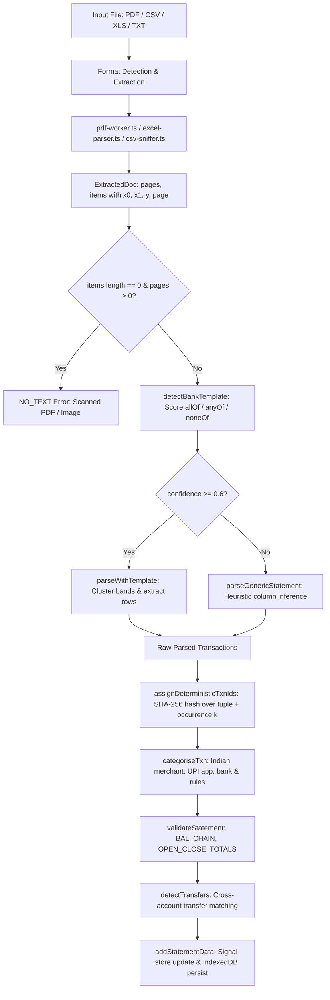

# AGENTS.md — Agent Guidelines & Architecture Manual for Kharcha

Welcome, Agent. This repository contains **Kharcha**, a client-side, privacy-first bank and credit card statement analyzer designed specifically for the Indian banking ecosystem.

This document serves as your operational manual, architectural blueprint, and non-negotiable rulebook when navigating, developing, refactoring, or extending this codebase.

---

## 1. Prime Invariants (Non-Negotiable Rules)

Whenever you make changes to this repository, you **MUST** strictly adhere to the following invariants:

### 1.1 Strict Zero-PII Policy
- **Never commit real bank statements or real personal data**: All test fixtures in `test/fixtures/` must be 100% synthetic or thoroughly anonymized (e.g. `SAMPLE USER`, account numbers ending with mock digits, synthetic UTR/RRN numbers).
- **Run the automated PII auditor**: Before completing any task, execute `pnpm pii:check`. If the auditor detects phone numbers, unmasked email addresses, PANs, or Aadhaar numbers, you must resolve them immediately.
- **Do not log sensitive financial details**: Never write narrations, passwords, account numbers, or balances to `console.log` in production code.

### 1.2 Zero-Cloud / Offline-First Invariant
- **No external network requests for financial processing**: All document parsing, text extraction, password unlocking, transaction categorization, and financial analysis must execute entirely client-side in the user's browser.
- **Content Security Policy (CSP)**: The application enforces `default-src 'none'`. External connections are restricted to telemetry (if enabled) and same-origin assets. PDF parsing and transaction logic must never require remote APIs or cloud parsers.
- **Memory-only password lifecycle**: PDF statement passwords must be held in memory closures only. They must **never** be persisted to IndexedDB, `localStorage`, or emitted in diagnostics.

### 1.3 Precise Accounting & Data Types
- **Money is ALWAYS integer Paise**: Standard IEEE 754 floating-point numbers are strictly forbidden for currency arithmetic.
  - Credit amounts are positive integers: ₹100.50 $\rightarrow$ `10050 as Paise`.
  - Debit amounts are negative integers: -₹50.00 $\rightarrow$ `-5000 as Paise`.
  - Always use `toPaise(rupees)` and `formatPaise(paise)` from `src/lib/money.ts`.
- **Dates are ALWAYS `IsoDate` strings (`YYYY-MM-DD`)**:
  - Never instantiate `new Date('DD/MM/YYYY')` for statement transaction dates (avoids timezone drift and cross-platform date parsing quirks).
  - Always parse dates using `parseDate(rawStr)` from `src/lib/dates.ts`.
- **Pure Parsing Functions**:
  - The parsing pipeline must be deterministic and pure: `(doc: ExtractedDoc) => ParseResult`.
  - No random numbers, system clock dependencies, or async I/O in the core parser logic.

### 1.4 Dependency Budget
- Kharcha maintains a lightweight runtime footprint ($\le 8$ production dependencies).
- Do not introduce heavy backend runtimes (e.g. Python, Docker), heavy OCR engines (e.g. `tesseract.js` WASM), or cloud LLM SDKs without explicit user authorization.

---

## 2. Codebase Architecture & Directory Map

```
karcha/
├── .github/                     # CI/CD Workflows & Dependabot
│   ├── dependabot.yml           # Weekly automated dependency maintenance
│   └── workflows/ci.yml         # GitHub Actions: Lint, Test, Build, PII Check
├── public/                      # Static assets, Web App Manifest, PWA icons
├── scripts/
│   └── check-pii.mjs            # Automated Zero-PII scanner for CI & pre-commit
├── src/
│   ├── app.tsx                  # Main application shell & tab routing
│   ├── main.tsx                 # Preact entry point & Vercel telemetry injection
│   ├── banks/                   # Bank-specific template definitions
│   │   ├── registry.ts          # Registry exporting all active templates
│   │   ├── hdfc-savings.ts      # HDFC Bank savings & netbanking templates
│   │   ├── hdfc-card.ts         # HDFC Bank credit card templates
│   │   ├── kotak-savings.ts     # Kotak Mahindra Bank statements
│   │   ├── icici-savings.ts     # ICICI Bank detailed savings statement
│   │   ├── icici-card.ts        # ICICI Bank credit card billing cycles
│   │   ├── sbi-savings.ts       # State Bank of India (OnlineSBI) templates
│   │   └── axis-savings.ts      # Axis Bank multi-column statements
│   ├── components/              # UI components
│   │   ├── import/              # Drag-and-drop dropzone, queue, password dialog
│   │   ├── overview/            # Financial KPI cards, monthly charts, merchants
│   │   ├── transactions/        # Virtualized table & adaptive Group By list
│   │   ├── review/              # Tie-out verification banner & row editor modal
│   │   ├── recurring/           # Subscriptions, bank fees, and unusual spikes
│   │   ├── settings/            # Theme, IndexedDB persistence, diagnostics export
│   │   └── ui/                  # Reusable primitives (Card, Badge, Button, Modal)
│   ├── data/                    # Bundled JSON reference data
│   │   ├── categories.json      # Structured 2-level category taxonomy
│   │   ├── merchants.json       # 250+ pan-Indian merchant patterns & aliases
│   │   └── narration-patterns.json # Regex rules for UPI, IMPS, NEFT, POS, ATM
│   ├── hooks/                   # Reactive state hooks (use-file-import, use-theme)
│   ├── lib/                     # Pure mathematical & format utilities
│   │   ├── money.ts             # Integer Paise currency math & Indian number formats
│   │   ├── dates.ts             # Strict DD/MM/YYYY date parser & year inference
│   │   ├── export.ts            # CSV / JSON exporter with formula injection defense
│   │   ├── diagnostics.ts       # PII-redacted layout metadata exporter
│   │   └── hash.ts              # SHA-256 deterministic transaction hashing
│   ├── pipeline/                # Statement processing pipeline
│   │   ├── index.ts             # Pipeline orchestrator (processExtractedDoc)
│   │   ├── extract/             # Format sniffers & Web Worker extractors
│   │   │   ├── pdf-worker.ts    # PDF.js Web Worker extraction & unlock handling
│   │   │   ├── excel-parser.ts  # Binary XLS (BIFF8) and XLSX workbook parser
│   │   │   ├── csv-sniffer.ts   # Delimited CSV & fixed-width TXT sniffer
│   │   │   └── types.ts         # ExtractedDoc, TextItem definitions
│   │   ├── detect/              # Content-based bank template detector
│   │   ├── parse/               # Coordinate-based template engine & generic parser
│   │   ├── validate/            # BAL_CHAIN, OPEN_CLOSE, and accounting validators
│   │   ├── dedup/               # Idempotent transaction deduplication
│   │   ├── transfers/           # Self-transfer cross-account matching engine
│   │   └── categorise/          # Indian UPI/PSP handles, merchants & categories
│   ├── store/                   # Reactive state signals & computed selectors
│   │   ├── index.ts             # Canonical signals (accounts, statements, txns)
│   │   ├── selectors.ts         # Computed views (groupedTxns, monthlyChartData)
│   │   └── persistence.ts       # IndexedDB storage adapter
│   ├── styles/                  # Tailwind CSS, minimal scrollbar, @media print
│   └── types/                   # Branded types & core domain models
├── test/                        # Vitest automated test suites
│   ├── fixtures/                # 100% synthetic statement fixtures (.txt, .csv, .xls)
│   ├── hdfc-parser.test.ts      # HDFC fixed-width & summary tie-out tests
│   ├── kotak-parser.test.ts     # Kotak CSV Dr/Cr column & PDF tests
│   ├── icici-xls.test.ts        # ICICI NetBanking XLS tests
│   ├── grouping.test.ts         # Group By dimensions & adaptive visibility tests
│   ├── categoriser.test.ts      # Merchant & UPI app resolution tests
│   └── validators.test.ts       # Balance chain & open/close tie-out tests
└── vercel.json                  # Production headers, CSP, and SPA rewrites
```

---

## 3. The Statement Processing Lifecycle

When an agent works on statement ingestion, understand the exact staged pipeline:



### Key Lifecycle Rules:
1. **Dashed Rulers & Tab Expansion**: Fixed-width text reports (like HDFC `.txt`) must expand tabs to 8 spaces (`expandTabs(line, 8)`) and use dashed divider patterns (`/^[-=]{4,}(\s+[-=]{4,})+/`) to extract column widths without character shifting.
2. **Fixed Column Grids**: In CSV files with long narrations, avoid variable-width accumulation. Use fixed column grids (`colIdx * 200`) in `csv-sniffer.ts` to prevent layout drift.
3. **Adaptive Amounts**: Kotak CSV exports use a single `Amount` column and separate `Dr / Cr` indicator column. Kotak PDF uses split `Withdrawal` and `Deposit` columns. Always set `amounts.style` accurately in the template (`'split-columns'` vs `'amount-with-drcr-column'`).
4. **Opening Balance Recovery**: If opening balance is not in metadata headers, check for in-table rows (`Opening Balance`, `Balance B/F`) or derive backwards from the first transaction: `firstTxn.balanceAfter - firstTxn.amount`.

---

## 4. How to Add Support for a New Bank

Follow this standard procedure whenever extending support for a new Indian bank or card issuer:

### Step 1: Create the Bank Template
Create `src/banks/<bank>-<product>.ts` implementing the `BankTemplate` interface:
```ts
import type { BankTemplate } from '@/pipeline/parse/types';

export const myBankTemplate: BankTemplate = {
  id: 'mybank-savings',
  version: '1.0',
  bank: 'MyBank' as any,
  product: 'savings',
  detect: {
    allOf: ['MYBANK|MYBK000'],
    anyOf: ['Statement of Account', 'Account Statement', 'Customer ID'],
  },
  header: {
    date: ['Date', 'Txn Date'],
    narration: ['Description', 'Narration', 'Particulars'],
    debit: ['Withdrawal', 'Debit', 'Dr.'],
    credit: ['Deposit', 'Credit', 'Cr.'],
    balance: ['Balance', 'Closing Balance'],
  },
  dates: {
    formats: ['DD/MM/YYYY', 'DD-MM-YYYY'],
  },
  amounts: {
    style: 'split-columns', // or 'amount-with-drcr-column'
  },
  rows: {
    ignoreLines: ['^Page \\d+ of \\d+', '^Generated On'],
  },
};
```

### Step 2: Register the Template
Export the template from `src/banks/registry.ts` and add it to `allTemplates`.

### Step 3: Create a 100% Synthetic Test Fixture
Add a synthetic fixture in `test/fixtures/<bank>-sample.<ext>`:
- Use `SAMPLE USER`, `000000001234` for account numbers.
- Ensure integer arithmetic ties out perfectly: $\text{Opening} + \text{Credits} - \text{Debits} == \text{Closing}$.

### Step 4: Write an Automated Test Suite
Create `test/<bank>-parser.test.ts`:
```ts
import fs from 'node:fs';
import path from 'node:path';
import { describe, expect, it } from 'vitest';
import { parseDelimitedText } from '@/pipeline/extract/csv-sniffer';
import { detectBankTemplate } from '@/pipeline/detect/detector';
import { processExtractedDoc } from '@/pipeline';

describe('MyBank Statement Parser', () => {
  it('parses synthetic MyBank statement with verified tie-out', async () => {
    const fixturePath = path.resolve(__dirname, 'fixtures/mybank-sample.csv');
    const content = fs.readFileSync(fixturePath, 'utf-8');
    const doc = parseDelimitedText(content, 'mybank-sample.csv');

    const detection = detectBankTemplate(doc);
    expect(detection.template?.id).toBe('mybank-savings');

    const result = await processExtractedDoc(doc, [], []);
    expect(result.statement.verification).toBe('verified');
    expect(result.txns.length).toBeGreaterThan(0);
  });
});
```

### Step 5: Verify Quality
Run all checks:
```bash
pnpm test
pnpm pii:check
pnpm lint
```

---

## 5. Standard Development & Verification Commands

| Command | Purpose |
| :--- | :--- |
| `pnpm dev` | Launch local Vite development server at `http://localhost:5173/` |
| `pnpm test` | Execute full Vitest automated test suite (must be 100% green) |
| `pnpm lint` | Run Biome linter and formatting checker across all files |
| `pnpm lint:fix` | Automatically apply Biome formatting and linter fixes |
| `pnpm pii:check` | Run automated Zero-PII scanner (`scripts/check-pii.mjs`) |
| `pnpm build` | Compile TypeScript and Vite production bundle |

---

## 6. Git Protocol for AI Agents

1. **Do not auto-commit without explicit permission**: If the user instructs "do not auto-commit", leave all modified files in the working directory for manual inspection.
2. **Never push commits (`git push`)**: AI agents must never push directly to remote branches unless specifically instructed by the user.
3. **Use conventional commit messages**: When committing, use logical scopes:
   - `feat(pipeline): ...`
   - `feat(ui): ...`
   - `test(fixtures): ...`
   - `ci(deploy): ...`
   - `chore(deps): ...`
4. **Git Author Identity**: Verify `git config user.name` and `git config user.email` to ensure commits reflect the user's intended GitHub identity.
